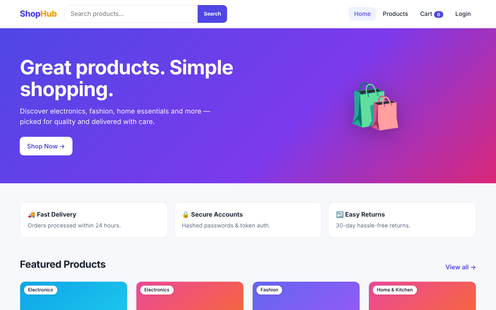
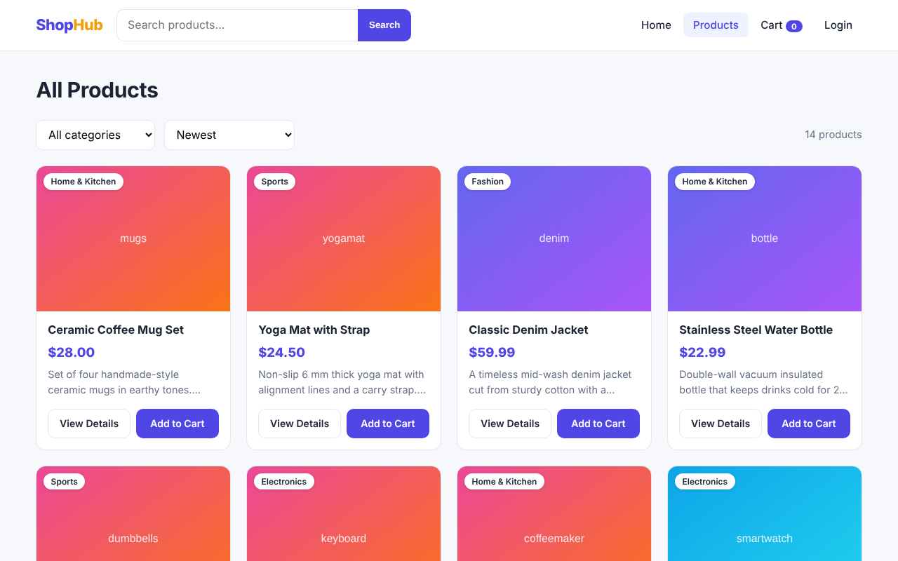
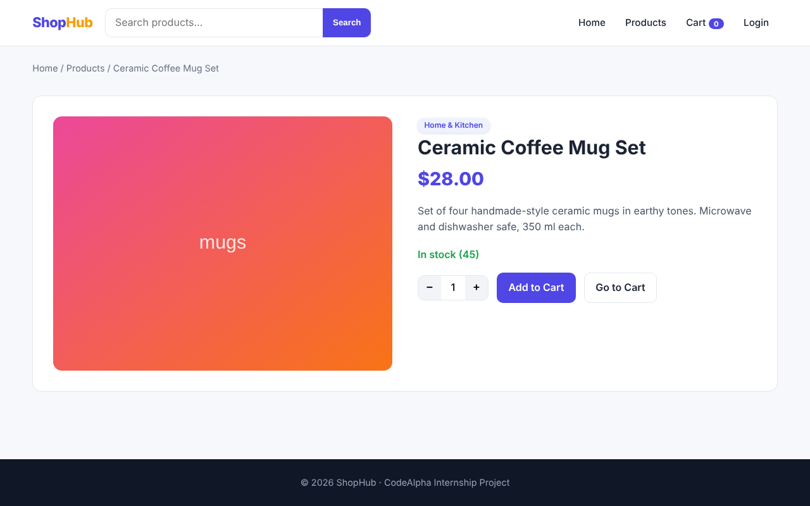
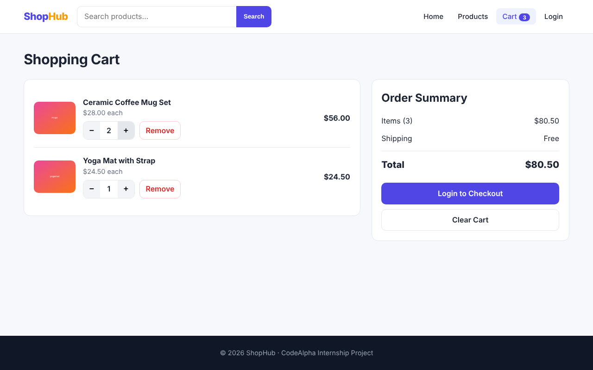
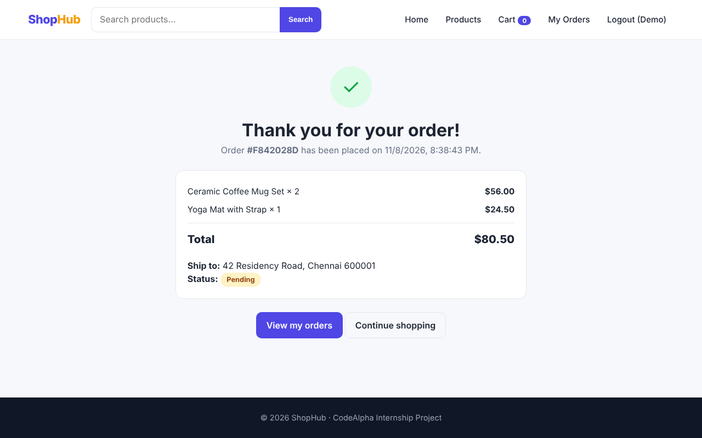
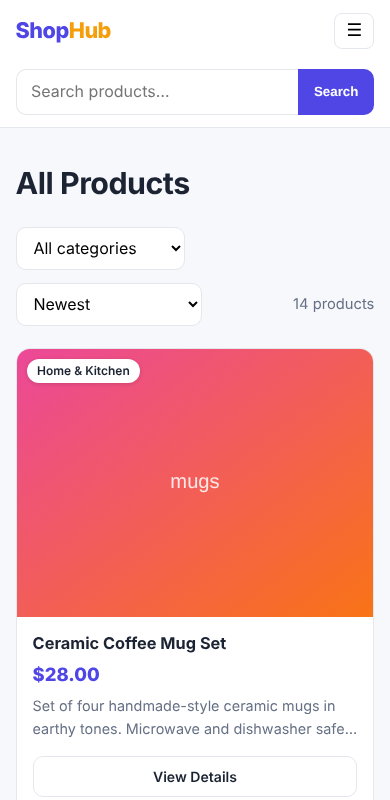

# ShopHub – Simple E-commerce Store (CodeAlpha Internship, Task 1)

A full-stack e-commerce website: browse and search products, view details, manage a shopping cart, register/login with JWT, place orders and see order history.

## Tech Stack

| Layer | Technology |
|---|---|
| Frontend | HTML5, CSS3, vanilla JavaScript (no build step) |
| Backend | Node.js, Express.js (REST API) |
| Database | MongoDB with Mongoose |
| Auth | JWT (`jsonwebtoken`) + `bcrypt` password hashing |
| Validation | `express-validator` (server) + client-side checks |

## Project Structure

```
codealpha-store/
├── backend/
│   ├── config/db.js            # MongoDB connection
│   ├── middleware/             # auth (JWT) + validation helpers
│   ├── models/                 # User, Product, Order
│   ├── routes/                 # auth, products, orders
│   ├── seed/seed.js            # sample product data
│   ├── server.js
│   └── .env.example
├── frontend/
│   ├── css/styles.css
│   ├── js/                     # config.js, common.js (API, auth, cart, UI helpers)
│   └── *.html                  # index, products, product, cart, login, register,
│                               # order-confirmation, orders
└── README.md
```

## Prerequisites

- [Node.js](https://nodejs.org) 18+
- MongoDB running locally (`mongodb://127.0.0.1:27017`) **or** a free [MongoDB Atlas](https://www.mongodb.com/atlas) connection string

## Installation & Running

```bash
# 1. Install backend dependencies
cd backend
npm install

# 2. Configure environment
# A ready-to-use .env is included (local MongoDB, dev JWT secret).
# If it is missing: cp .env.example .env   (Windows: copy .env.example .env)
# Change JWT_SECRET before any real deployment, and set MONGODB_URI for Atlas.

# 3. Load sample products (14 items)
npm run seed

# 4. Start the API (and the frontend, since SERVE_FRONTEND=true)
npm start
```

Open **http://localhost:5000** — the backend serves the frontend, so one command runs everything.

### Running the frontend separately (optional)

Set `SERVE_FRONTEND=false` in `.env`, then serve the `frontend/` folder with any static server, e.g.:

```bash
cd frontend
npx serve -l 5500
```

Open http://localhost:5500. `frontend/js/config.js` points to the API at `http://localhost:5000/api`; the allowed origins are set in `CLIENT_ORIGIN` in `.env` (add yours if you use another port).

## Features

- **Homepage** – hero section, featured products, nav links (Home, Products, Cart, Login), global search bar
- **Product listing** – cards with image, name, price, short description, *View Details* and *Add to Cart*; search, category filter, sorting and pagination
- **Product details** – full info, stock status, quantity picker, add to cart
- **Cart** – increase/decrease quantity, remove items, auto-calculated total, persisted in `localStorage`
- **Auth** – register, login, logout; passwords hashed with bcrypt; JWT sent as `Authorization: Bearer <token>`
- **Orders** – authenticated checkout with shipping address, confirmation page, order history

## Security & Data Integrity

- Passwords are never stored in plain text (bcrypt hash, excluded from queries by default).
- Order prices are always read from the database – the client cannot tamper with them.
- Stock is decremented atomically at checkout and rolled back if any item can't be fulfilled.
- Inputs validated on both client and server; centralized error handler returns friendly JSON errors.
- Regex search input is escaped; all user-provided text is HTML-escaped when rendered.

## REST API

| Method | Endpoint | Auth | Description |
|---|---|---|---|
| POST | `/api/auth/register` | – | Create account `{name, email, password}` |
| POST | `/api/auth/login` | – | Login `{email, password}` → `{token, user}` |
| GET | `/api/auth/me` | ✔ | Current user |
| GET | `/api/products` | – | List; query: `search`, `category`, `sort`, `featured`, `page`, `limit` |
| GET | `/api/products/categories` | – | Distinct categories |
| GET | `/api/products/:id` | – | Single product |
| POST | `/api/orders` | ✔ | Place order `{items:[{productId, quantity}], shippingAddress}` |
| GET | `/api/orders` | ✔ | Order history of logged-in user |
| GET | `/api/orders/:id` | ✔ | One of the user's orders |

## Database Collections

- **users** – `name`, `email` (unique), `password` (hashed)
- **products** – `name`, `description`, `price`, `image`, `category`, `stock`, `featured`
- **orders** – `user`, `products[]` (product, name, price, quantity), `totalAmount`, `shippingAddress`, `orderDate`, `status`

## Quick Test Flow

1. Browse products, search for "coffee", open a product, add to cart.
2. Open the cart, change quantities, remove an item.
3. Click *Login to Checkout* → register → return to the cart.
4. Enter an address → *Place Order* → confirmation page.
5. Visit *My Orders* to see the history; stock on the product page drops accordingly.

## Screenshots

Product photos load from picsum.photos; the screenshots below use stand-in images.








## Publishing to GitHub

```bash
git init
git add .
git commit -m "CodeAlpha Task 1: simple e-commerce store"
git branch -M main
git remote add origin https://github.com/<your-username>/codealpha-ecommerce-store.git
git push -u origin main
```

`.env` is git-ignored — never commit real secrets.
